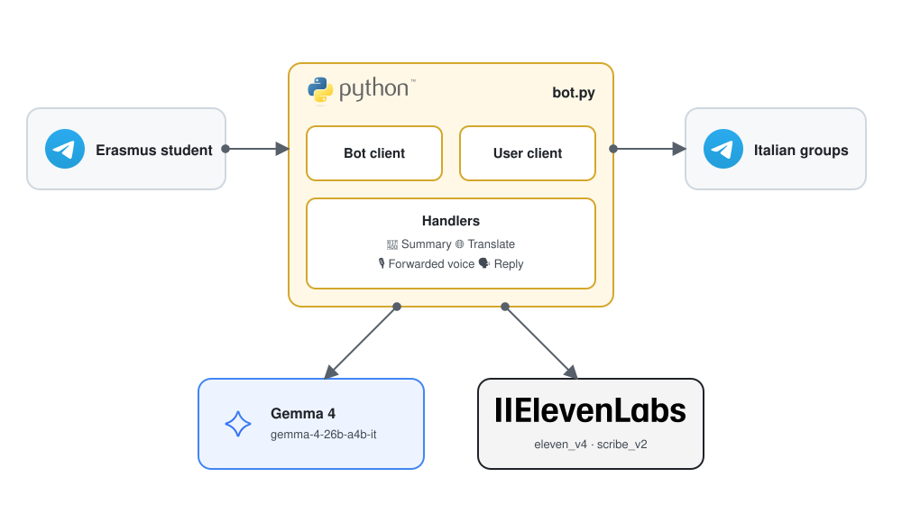
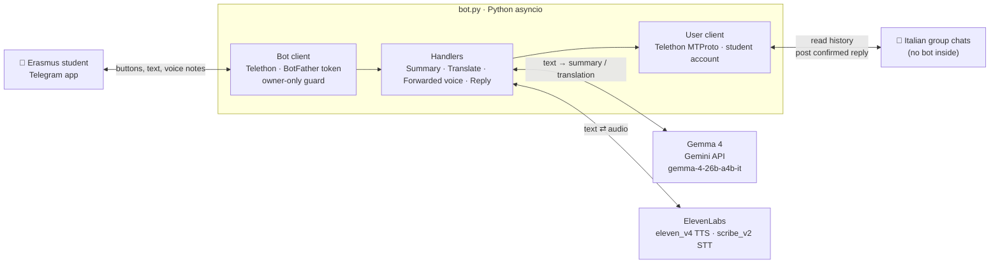
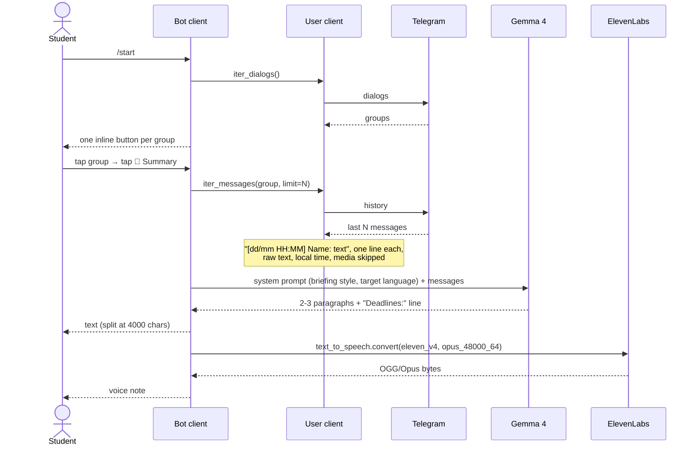
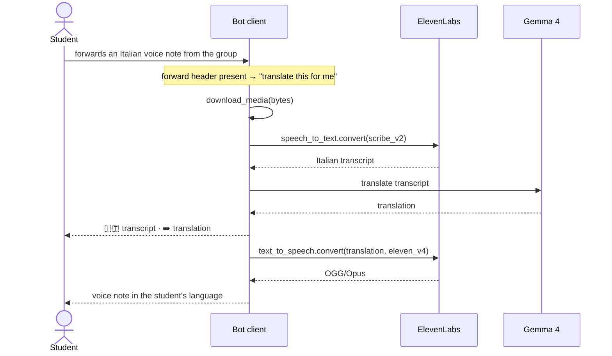
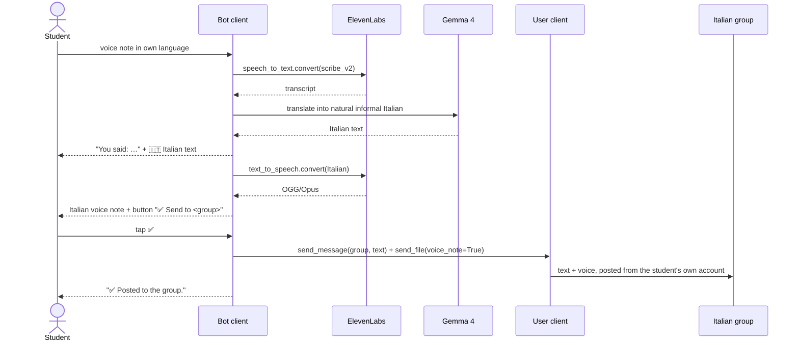

# Architecture

Erasmus Group Translator is a single Python process that bridges three things: the student's
Telegram account, a private Telegram bot, and two AI services (Gemma 4 for language, ElevenLabs for voice).

## Components

| Component | Role | Notes |
|---|---|---|
|  **Student (Telegram app)** | Talks to the bot in a private chat. Taps inline buttons, forwards or records voice notes. | Only the `OWNER_ID` is served; other users are silently ignored. |
|  **bot.py** | One asyncio process, two Telethon clients, four handlers. | No database, no web server, no inbound ports: both clients open outbound MTProto connections, so no ngrok or webhook is needed. |
| **Bot client** | The user interface: `/start`, inline keyboards, text and voice replies. Receives forwarded and recorded voice notes. | Authenticated with the BotFather token. |
| **User client** | Reads the groups the student is already in: dialogs and message history. Posts the confirmed reply. | Authenticated once with phone + code (MTProto). Session stored in `user.session`. **No bot is ever added to the group.** |
|  **Gemma 4** (Gemini API) | Summaries, line-by-line chat translation, translation of voice transcripts, translation of the student's reply into Italian. | `gemma-4-26b-a4b-it`, `thinking_level="minimal"`, `max_output_tokens=2048`. Retry with exponential backoff, fallback to `gemma-4-31b-it`. |
|  **ElevenLabs** | Text-to-speech (`eleven_v4`, output `opus_48000_64`) and speech-to-text (`scribe_v2`). | Opus output is an OGG container, which Telegram accepts as a voice note as-is. |

## Component diagram (Mermaid)

## Flows

### 📝 Summary (text + voice)

### 🌐 Translate

Same read path as the summary. The prompt asks for one output line per input line, with the
`[date time] Name:` prefix kept verbatim, so the student sees who said what. No ElevenLabs call.

### 🎙️ Forwarded voice note → voice note in your language

### 🗣️ Reply in your language

A voice note **recorded** by the student (no forward header) takes this path instead.

## Data and configuration

- **`.env`**: Telegram `API_ID`/`API_HASH`/`PHONE`, `BOT_TOKEN`, `OWNER_ID`, `GEMINI_API_KEY`,
  `ELEVENLABS_API_KEY`/`ELEVENLABS_VOICE_ID`, `TARGET_LANG`, `SUMMARY_LIMIT`. Never committed.
- **`user.session` / `bot.session`**: Telethon session files (SQLite). The user session is equivalent to
  being logged in to the student's account: keep it private, never commit it.
- **In-memory state**: the last selected group and the pending reply draft. Lost on restart by design.
- **`last_llm_input.txt`**: debug dump of the last text sent to the model (UTF-8), ignored by git.

## Design decisions and known limits

- **No bot in the group** is the whole point: it removes the "ask the admin" step and keeps the group
  unaware. The trade-off is that the student's own account does the reading, so the session file must
  be protected like a password.
- **Owner-only bot**: a single `OWNER_ID`; the bot is personal, not multi-tenant.
- **Thinking off on Gemma 4**: with default thinking the model spent ~1,000 hidden tokens and 3x the time
  per call, and with a small `max_output_tokens` the budget was eaten entirely by reasoning, returning an
  empty answer. `thinking_level="minimal"` is the only level the Gemma endpoint accepts.
- **Gemma backend 500s**: the Gemini API occasionally returns instant `500 INTERNAL` bursts for Gemma 4,
  independent of the input. The SDK does not retry by default, so the bot retries 5 times with backoff
  and then tries the 31B model once.
- **Translate fidelity**: with 50 lines the model may occasionally merge or skip a line. Chunking into
  blocks of ~15 lines (in parallel) is the planned fix if it shows up in practice.
- **Date range**: `iter_messages(offset_date=…, reverse=…)` would allow "since Monday" or "last week"
  presets; not implemented yet.
