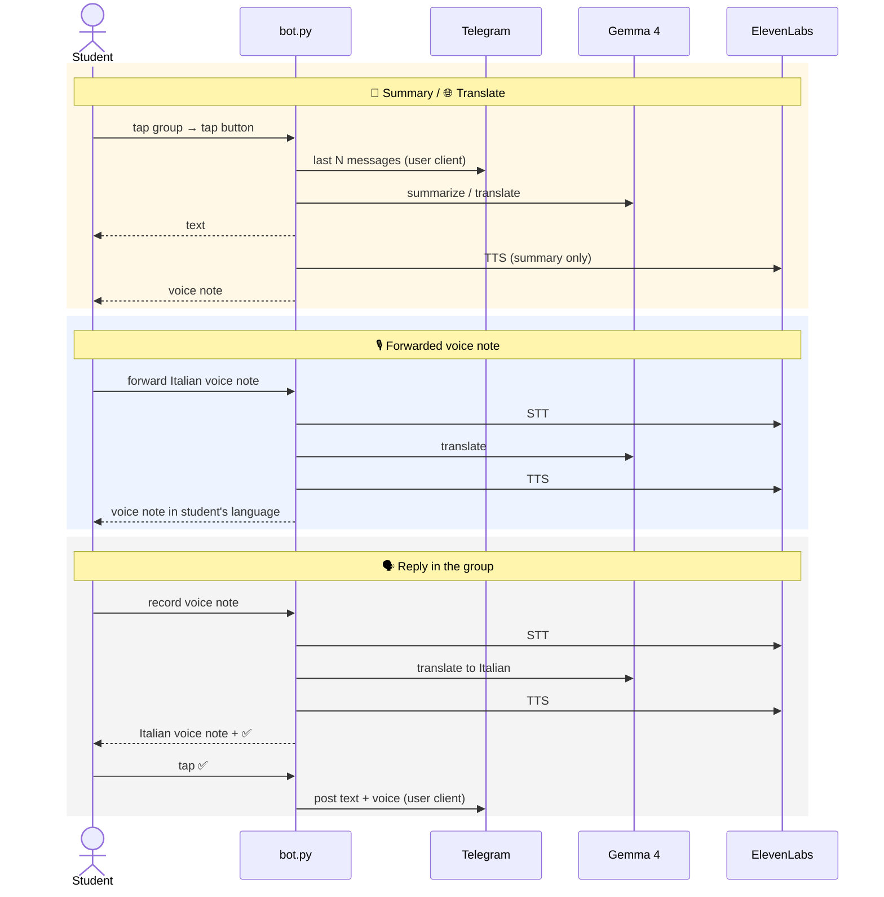

# Architecture

| Component | Role |
|---|---|
|  Erasmus student | Private chat with the bot |
|  `bot.py` | One asyncio process, two Telethon clients |
| Bot client | UI: buttons, voice notes (BotFather token) |
| User client | Reads the groups, posts the reply (student's account, no bot in the group) |
|  Gemma 4 | `gemma-4-26b-a4b-it` |
|  ElevenLabs | `eleven_v4` TTS · `scribe_v2` STT |

## Flows

